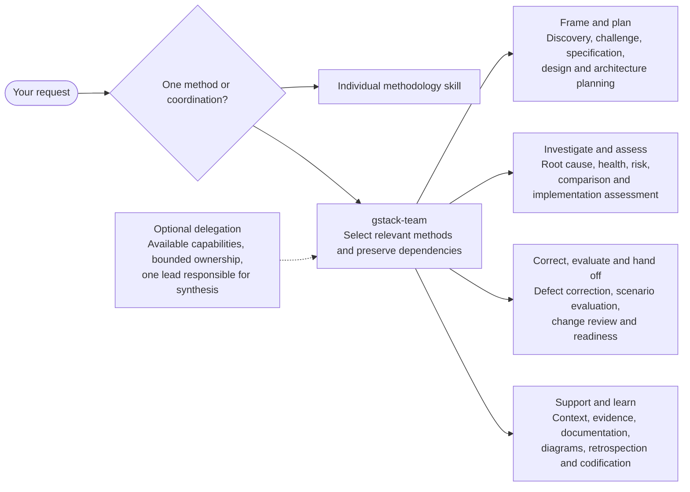
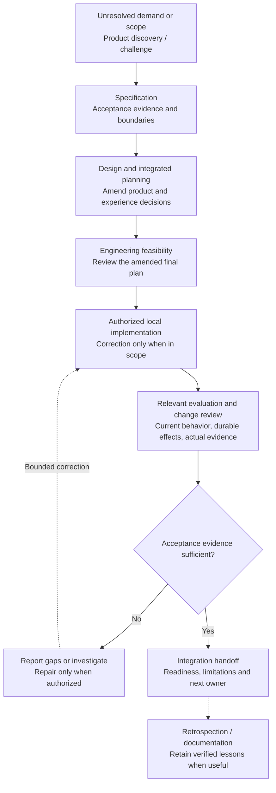

# GStack Generic

A curated methodology-only adaptation of Garry Tan's gstack for local development. Version 1.2.2 contains 27 distinct methods and one coordinator, consolidated from the previous 60 skills. Methods define inputs, decisions, evidence, results, and scope; they do not prescribe tools or executable commands.

The installed bundle lives in `plugins/gstack-power-team`. The authoring catalog, upstream tracking, selection rationale, and maintenance utilities live outside that bundle.

## Install

The recommended source is [Pablo's Plugins](https://github.com/pablopoo/codex-marketplace), the shared catalog for GStack Power Team and Universal Lever. Its marketplace ID is `pablopoo-plugins`. This repository's own `gstack-local` catalog remains available for compatibility.

### Codex CLI

With a Codex CLI supporting plugin commands, register the central marketplace and install GStack Power Team:

```sh
codex plugin marketplace add pablopoo/codex-marketplace
codex plugin add gstack-power-team@pablopoo-plugins
```

Adding a marketplace makes plugins discoverable; it does not install them. Start a new task after installation to load the skills. The central catalog is currently private, so authenticated GitHub access is required to the catalog and the plugin repositories it references.

**Compare revisions before switching sources.** A central-catalog install uses its selected, reviewed commit, not necessarily this repository's latest `main`. See the [central catalog's plugin list](https://github.com/pablopoo/codex-marketplace#plugins) for the currently selected version and commit SHA. Do not replace a newer local installation blindly or enable duplicate copies from both catalogs. Registering the central source does not migrate an existing installation.

### Compatibility source

The existing repository marketplace remains unchanged:

```sh
codex plugin marketplace add pablopoo/gstack-generic
codex plugin add gstack-power-team@gstack-local
```

For maintainers, register a local clone with `codex plugin marketplace add /path/to/gstack-generic` instead. The manifest is [`.agents/plugins/marketplace.json`](.agents/plugins/marketplace.json), named `gstack-local` and displayed as **Local GStack Plugins**. Choose one installation source; these alternatives are not additional setup steps for a central-catalog installation.

### Codex / ChatGPT Desktop

1. Register `pablopoo/codex-marketplace` using the CLI command above on the same computer and OS user as the desktop Codex runtime. Registering it on a separate SSH host does not configure the local desktop.
2. Restart the app, open **Plugins**, and select **Pablo's Plugins** as the source.
3. Open **GStack Power Team**, compare its version with any existing installation, and select **Install** when appropriate. Skip installation if you already installed that revision through the CLI.
4. Start a new Codex or ChatGPT Work conversation and ask it to use GStack Power Team or an individual method.

Controls and availability vary by app version, account, and workspace. See the [official marketplace guide](https://developers.openai.com/plugins/build/plugins#build-your-own-curated-plugin-list) and [ChatGPT Help: installing and using plugins](https://help.openai.com/en/articles/20001256-plugins-in-chatgpt).

For the installation-card screenshot, see the [official OpenAI Help article](https://help.openai.com/en/articles/20001256-plugins-in-chatgpt). The image is not embedded or redistributed here.

### ChatGPT workspace import from the web

An eligible workspace administrator can import the central catalog:

1. Open the [Admin Console](https://admin.openai.com), choose the intended ChatGPT workspace, then **Plugins → Add → Import marketplace**.
2. Set **Source** to `https://github.com/pablopoo/codex-marketplace`, leave **Path** empty, and set **Branch, tag, or commit** to `main`.
3. Authorize a GitHub account that can read the catalog and both referenced private repositories, `pablopoo/gstack-generic` and `pablopoo/universal-lever`.
4. Review all import results and configure plugin availability. Members can then find and install allowed plugins in their workspace directory.

Import processes the catalog's valid plugins, not just GStack. Workspace permissions and plugin settings still apply. Following catalog `main` permits catalog updates, but does not bypass a plugin's pinned source commit. See [ChatGPT Help: importing and syncing marketplaces](https://help.openai.com/en/articles/20001504-importing-and-syncing-plugin-marketplaces-from-github).

[Open the ChatGPT Plugins directory](https://chatgpt.com/plugins). This opens the directory; it does not register this Git source or install GStack. The official guides do not document a repository-specific one-click import/install link. A GitHub repository is not automatically a public plugin-directory listing.

### Updates

Installed plugins use cached snapshots. A push alone does not replace an installed bundle. Refresh the selected marketplace and update or reinstall the intended plugin revision, then start a new task. Existing tasks may retain previously loaded instructions. A central-catalog pin must be advanced by its maintainer before that source can offer a newer plugin revision.

## Use the methods

Ask for the coordinator when several decisions depend on one another:

```text
Use GStack Power Team to plan this change. Reuse established requirements,
resolve product and experience gaps, then assess engineering feasibility
against the amended plan. Stop at a plan; do not implement yet.
```

Or select an individual method:

```text
Use gstack-change-review to review the current local changes. Report defects,
regressions, and missing evidence without editing the product.
```

```text
Use gstack-root-cause-investigation to establish why this failure occurs.
Separate observations from hypotheses; do not assume a repair is authorized.
```

The [method index](plugins/gstack-power-team/references/method-index.md) lists all 27 methods and their entry conditions. Names identify instructions, not executable commands. Use the smallest applicable set; a straightforward review does not need discovery, design, or a team of agents.

## Skills and coordination

This is one plugin containing **28 skills: 27 methods and the `gstack-team` coordinator**. The groups below organize the methods for browsing; they are not extra skills or permanent agents.



The coordinator uses existing decisions and current evidence to skip satisfied dependencies. It can delegate distinct independent work when the host supports it, but prescribes no fixed models or agent roster. See the [delegation contract](plugins/gstack-power-team/references/delegation-contract.md).

### How work can flow

This is an example for a consequential local change, **not a mandatory sequence**. Enter at the unresolved decision; report-only and plan-only requests stop at their requested artifact.



The [process map](plugins/gstack-power-team/references/process-map.md) defines the actual dependencies. Investigation establishes causes; correction changes behavior. Validation covers the actual combined result. Local readiness does not authorize publication or cloud deployment.

## Structure and checks

| Location | Purpose |
| --- | --- |
| [`plugins/gstack-power-team/`](plugins/gstack-power-team/) | Installable text-only skills, shared references, metadata and license |
| [`methodology/`](methodology/) | Authoring catalog, selection decisions, upstream mappings and review records |
| [`gstack-skills/`](gstack-skills/) | Original text snapshot for comparison and attribution; not installed |
| [`scripts/`](scripts/) and [`tests/`](tests/) | Repository maintenance utilities and checks; not installed |

The methods add no runtime dependencies, hooks, MCP servers, or model configuration. Applying them to actual project behavior requires appropriate host access and the project's own capabilities. Written planning or critique does not itself require a specific execution tool. Maintenance commands below are for repository authors, not instructions embedded in the methodologies. They require Python 3; pinned upstream comparisons also require Git and an upstream checkout.

```sh
python3 -B scripts/generate_methodologies.py --check
python3 -B -m unittest discover -s tests
```

The checks cover generation, update-review acceptance, snapshot handling and package boundaries. They do not guarantee agent behavior across every host or project.

## Maintenance

Follow [the upstream update process](methodology/UPDATE.md). Read [the selection record](methodology/selection.md) to see which old methods were merged or excluded. Generate the bundle with `python3 scripts/generate_methodologies.py`; verify reproducibility with its `--check` option. Run `python3 -m unittest discover -s tests` for the maintenance workflow checks.

The 1.0.0 change intentionally retires old skill names where methods were consolidated. The coordinator and method index route to the new methods. Installed instructions have no dependency on this repository's authoring scripts or raw upstream snapshot.

Version 1.1.0 incorporates test-value assessment and evidence-backed reuse into existing methods, expands scenario evaluation to nonvisual behavior and durable effects, and strengthens review freshness and handoff evidence. See [the update record](methodology/updates/1.1.0.md).

Version 1.2.0 adds preregistered evaluation, semantic reassessment of aging changes, purposeful motion, explicit approval provenance, integrated evidence, and lean guidance maintenance without expanding the method count. The package guard rejects unexpected operational payloads. See [the update record](methodology/updates/1.2.0.md).

Version 1.2.1 omits optional author contact metadata and adds a package check against its reintroduction. Methodologies and license attribution are unchanged. See [the update record](methodology/updates/1.2.1.md).

Version 1.2.2 adds complete installed license/notice coverage, generated modification notices and source-scope checks. It excludes two uncleared reference texts from the selected archive and replaces the installation screenshot embed with a link. See [the update record](methodology/updates/1.2.2.md).

## Attribution

Derived from **[Garry Tan's gstack](https://github.com/garrytan/gstack)**. This is an independent methodology-only adaptation, not the original tool stack. Adaptation author: Pablo Poo.

- Source plugin version: **1.2.2**; a marketplace may select an older reviewed revision.
- Text-only upstream snapshot: **1.91.317.0**, commit [`9f44f188d117b5aa714c7698aa29bc5c7785cbfa`](https://github.com/garrytan/gstack/tree/9f44f188d117b5aa714c7698aa29bc5c7785cbfa).
- Original notices and upstream licenses are preserved in [`gstack-skills/NOTICE.md`](gstack-skills/NOTICE.md) and [`gstack-skills/licenses/`](gstack-skills/licenses/).
- Original contributions are MIT; third-party terms are not replaced by that grant. The installed package declares `MIT AND Apache-2.0` and includes complete licenses, notices and modification marks. See the [repository scope](NOTICE.md), [root license](LICENSE), and [installed notices](plugins/gstack-power-team/NOTICE.md).

Upstream tool integrations, installation commands, named frameworks, model assignments, and public-cloud deployment workflows are intentionally not imported into the methodology skills. The original archive remains specific by design; it is not part of the installed bundle.
