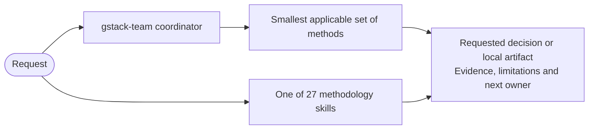

# GStack Power Team

Version 1.2.3 is a curated collection of 27 development methodologies and one coordinator derived from Garry Tan's gstack. Each method defines its inputs, decision criteria, result, and scope. Methods can be used independently or coordinated through their actual dependencies.

The installed bundle contains methodological text and packaging metadata. It prescribes no commands, named tools, frameworks, platforms, models, installations, or deployment procedures. Local development through readiness and handoff remains the boundary.

The method index selects by desired outcome. The process map preserves dependencies, including engineering review after amended product and experience planning. Collaboration is optional and based on capabilities and ownership.

This revision strengthens fair comparisons, aging-change assessment, purposeful motion, approval provenance, integrated evidence, and concise guidance within the existing methods. Older skill names are not retained as executable aliases. Source history, migration decisions, update guidance, and authoring utilities live in the source repository outside the installed bundle.

Adapted from Garry Tan's gstack, upstream 1.91.317.0 at 9f44f188d117b5aa714c7698aa29bc5c7785cbfa. Adaptation author: Pablo Poo.

## Install

The recommended source is [Pablo's Plugins](https://github.com/pablopoo/codex-marketplace), marketplace ID `pablopoo-plugins`:

```sh
codex plugin marketplace add pablopoo/codex-marketplace
codex plugin add gstack-power-team@pablopoo-plugins
```

The central catalog and both plugin repositories are public; reading these Git sources does not require GitHub credentials. Additional private sources require authenticated read access. Workspace-admin import may still require GitHub authorization and workspace permissions. The catalog installs its selected, reviewed commit, which can differ from this source's `main`. See the [central catalog's plugin list](https://github.com/pablopoo/codex-marketplace#plugins) for the currently selected version and commit SHA. Compare versions before changing sources: do not downgrade a newer local copy or enable duplicates. These instructions do not migrate existing installations.

For compatibility, the original repository catalog remains available:

```sh
codex plugin marketplace add pablopoo/gstack-generic
codex plugin add gstack-power-team@gstack-local
```

Choose one installation source. For desktop use, register the source on the same computer and OS user as the Codex runtime, restart the app, open **Plugins**, select **Pablo's Plugins** (or **Local GStack Plugins** for the compatibility source), then install **GStack Power Team** if that revision is not already installed. Start a new conversation to load it. A push does not automatically replace the cached installation.

These packaging instructions are not methodology steps. See the [source installation guide](https://github.com/pablopoo/gstack-generic#install) for workspace-admin import, version caveats, and links to official installation help, or the [official plugin guide](https://developers.openai.com/plugins/build/plugins) for host setup.

## Select a method

Use [the method index](references/method-index.md) to choose an individual skill, or ask `gstack-team` to coordinate dependent decisions. For example: "Use gstack-change-review to assess local changes without editing" or "Use GStack Power Team to produce a bounded plan; do not implement."



The [process map](references/process-map.md) preserves dependencies, not a compulsory itinerary. Existing evidence can satisfy a prerequisite. Distinct independent work may be delegated when supported and authorized; no fixed models or permanent team is required. Local readiness does not authorize deployment or publication.

## Source and verification

The [source repository](https://github.com/pablopoo/gstack-generic) contains the authoring catalog, update process, selected text archive, tests and fuller diagrams. None is needed as a runtime dependency of these skills. Repository checks verify generation, package boundaries and upstream-review bookkeeping; they do not guarantee agent compliance on every host. Version 1.2.3 clarifies installation from public sources; methodology content and legal notices are unchanged.

Derived from [garrytan/gstack](https://github.com/garrytan/gstack/tree/9f44f188d117b5aa714c7698aa29bc5c7785cbfa). Original contributions and MIT-derived text retain MIT terms; Apache-derived guidance retains Apache-2.0 obligations. The package expression is `MIT AND Apache-2.0`, not an MIT-only relicense. See [LICENSE](LICENSE), [NOTICE.md](NOTICE.md) and [licenses/](licenses/) for the self-contained attribution, scope and complete terms. Named sources in legal notices are provenance, not tool dependencies.
